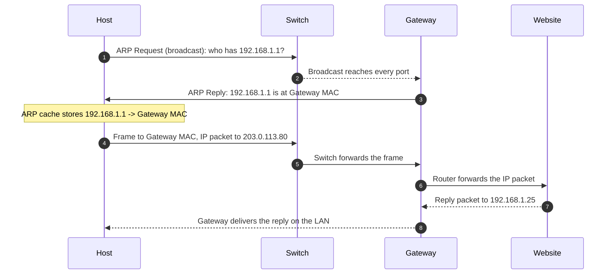
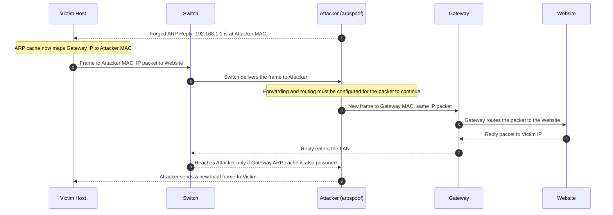

<h1 dir="rtl" align="right">راهنمای <code>arpspoof</code>؛ تغییر مسیر ترافیک در شبکهٔ محلی</h1>

<blockquote dir="rtl" align="right"><p><strong>محدودهٔ استفاده:</strong> این راهنما برای یادگیری و آزمایش در شبکهٔ شخصی یا محیطی است که اجازهٔ صریح آزمون آن را دارید. ارسال پاسخ‌های ARP جعلی می‌تواند ارتباط دستگاه‌ها را مختل کند. مثال‌ها را روی شبکهٔ واقعی دیگران اجرا نکنید.</p></blockquote>

<h2 dir="rtl" align="right">پروتکل ARP چیست؟</h2>

<p dir="rtl" align="right">در شبکهٔ محلی، دستگاه‌ها برای فرستادن یک <strong>Ethernet frame</strong> به آدرس سخت‌افزاری مقصد یعنی <code>MAC address</code> نیاز دارند. اما برنامه‌ها و مسیریابی با آدرس منطقی مثل <code>IPv4 address</code> کار می‌کنند. پروتکل <strong>ARP (Address Resolution Protocol)</strong> آدرس IPv4 یک دستگاه محلی را به MAC آن نگاشت می‌کند.</p>

<p dir="rtl" align="right">این نگاشت معمولاً مدتی در <strong>ARP cache</strong> سیستم‌عامل می‌ماند تا دستگاه برای هر بسته دوباره سؤال نکند. ARP خودش آدرس IP را به MAC «تبدیل» نمی‌کند؛ فقط پاسخ می‌دهد که برای رسیدن به یک IPv4 روی همین شبکهٔ محلی، از چه MACی استفاده شود.</p>

<h2 dir="rtl" align="right">دستگاه چطور Gateway را پیدا می‌کند؟</h2>

<p dir="rtl" align="right">فرض کنیم تنظیمات شبکهٔ یک کامپیوتر چنین است:</p>

<table dir="rtl">
<tr><th dir="rtl" align="right">مورد</th><th dir="rtl" align="right">نمونه</th></tr>
<tr><td dir="rtl" align="right">آدرس IPv4 کامپیوتر</td><td dir="rtl" align="right"><code>192.168.1.25</code></td></tr>
<tr><td dir="rtl" align="right">شبکهٔ محلی</td><td dir="rtl" align="right"><code>192.168.1.0/24</code></td></tr>
<tr><td dir="rtl" align="right">دروازهٔ پیش‌فرض (Default gateway)</td><td dir="rtl" align="right"><code>192.168.1.1</code></td></tr>
<tr><td dir="rtl" align="right">آدرس IPv4 وب‌سایت</td><td dir="rtl" align="right"><code>203.0.113.80</code></td></tr>
</table>

<p dir="rtl" align="right">وقتی کامپیوتر می‌خواهد به <code>203.0.113.80</code> وصل شود، ابتدا جدول مسیریابی را بررسی می‌کند. چون این مقصد در شبکهٔ محلی <code>192.168.1.0/24</code> نیست، کامپیوتر بسته را به <strong>Default gateway</strong> می‌فرستد. برای ساخت Ethernet frame باید MAC گیت‌وی را بداند.</p>

<p dir="rtl" align="right">اگر این MAC در ARP cache نباشد، کامپیوتر یک <strong>ARP Request</strong> به‌صورت broadcast در شبکهٔ محلی می‌فرستد: «چه کسی IPv4 برابر <code>192.168.1.1</code> را دارد؟ پاسخ را به <code>192.168.1.25</code> بده.» دستگاهی که آن IPv4 را دارد، با <strong>ARP Reply</strong>، MAC خودش را اعلام می‌کند. کامپیوتر نتیجه را cache می‌کند و فریم را به MAC گیت‌وی می‌فرستد.</p>



<h3 dir="rtl" align="right">سه نکته دربارهٔ مسیر عادی</h3>

<p dir="rtl" align="right">• <strong>در شبکهٔ محلی، ARP کار نگاشت IP به MAC را انجام می‌دهد.</strong> برای مقصد بیرون از subnet، کامپیوتر MAC خود وب‌سایت را پیدا نمی‌کند؛ MAC گیت‌وی را پیدا می‌کند.</p>
<p dir="rtl" align="right">• <strong>فریم Ethernet با بستهٔ IP یکی نیست.</strong> در مثال بالا، MAC مقصد frame برابر MAC گیت‌وی است، اما مقصد IP packet همچنان <code>203.0.113.80</code> است.</p>
<p dir="rtl" align="right">• <strong>روتر frame را در هر پیوند محلی دوباره می‌سازد.</strong> معمولاً آدرس‌های IP مبدأ و مقصد تا مقصد نهایی باقی می‌مانند، ولی آدرس‌های MAC متناسب با هر پیوند عوض می‌شوند.</p>

<h2 dir="rtl" align="right">این ابزار چه تغییری ایجاد می‌کند؟</h2>

<p dir="rtl" align="right">ابزار <code>arpspoof</code> از مجموعه‌ابزار <code>dsniff</code> است. این برنامه در شبکهٔ محلی <strong>پاسخ‌های جعلی ARP</strong> می‌فرستد تا دستگاه موردنظر یک نگاشت نادرست در ARP cache خود نگه دارد. برای نمونه، ممکن است به کامپیوتر هدف اعلام شود که <code>192.168.1.1</code> (آدرس Gateway) روی MAC دستگاه واسط قرار دارد.</p>

<p dir="rtl" align="right">اگر کامپیوتر این پاسخ را بپذیرد، frameهایی را که باید به Gateway برسند به MAC دستگاه واسط می‌فرستد. اگر Gateway هم نگاشت نادرستی برای IPv4 کامپیوتر هدف بپذیرد، پاسخ‌های برگشتی نیز ممکن است ابتدا به دستگاه واسط برسند. این وضعیت را معمولاً <strong>ARP spoofing</strong> یا <strong>ARP poisoning</strong> می‌نامند.</p>



<p dir="rtl" align="right">در این دیاگرام، <code>arpspoof</code> <strong>ARP mapping</strong> را دستکاری می‌کند؛ این ابزار به‌تنهایی محتوای IP packet را رمزگشایی نمی‌کند. رمزنگاری‌هایی مانند <strong>HTTPS/TLS</strong> همچنان محتوای برنامه را محافظت می‌کنند. همچنین، رسیدن ترافیک به سیستم واسط به معنی عبور موفق آن نیست: forwarding، route و firewall نیز در نتیجه نقش دارند.</p>

<h2 dir="rtl" align="right">نصب و پیش‌نیازها</h2>

<p dir="rtl" align="right">برای نصب ابزار در Debian و Ubuntu، بستهٔ <code>dsniff</code> را نصب کنید:</p>

```bash
sudo apt install dsniff
```

<p dir="rtl" align="right">برای اینکه یک Linux host بسته‌ها را بین رابط‌های شبکه مسیریابی کند، ممکن است لازم باشد <strong>IPv4 forwarding</strong> فعال شود. این تنظیم را فقط در آزمایشگاه و پس از ثبت مقدار اولیه تغییر دهید:</p>

```bash
sysctl net.ipv4.ip_forward
sudo sysctl -w net.ipv4.ip_forward=1
```

<p dir="rtl" align="right">فعال‌کردن forwarding به‌تنهایی route یا اجازهٔ عبور از firewall ایجاد نمی‌کند. در پایان، مقدار را به وضعیت قبلی برگردانید؛ اگر مقدار اولیه <code>0</code> بود:</p>

```bash
sudo sysctl -w net.ipv4.ip_forward=0
```

<h2 dir="rtl" align="right">دستور و گزینه‌های اصلی</h2>

<p dir="rtl" align="right">طبق راهنمای <code>arpspoof(8)</code>، ساختار کلی دستور چنین است:</p>

```text
arpspoof [-i interface] [-c own|host|both] [-t target] [-r] host
```

<table dir="rtl">
<tr><th dir="rtl" align="right">گزینه</th><th dir="rtl" align="right">کاربرد</th></tr>
<tr><td dir="rtl" align="right"><code>-i interface</code></td><td dir="rtl" align="right">انتخاب network interface، مانند <code>eth0</code>.</td></tr>
<tr><td dir="rtl" align="right"><code>-t target</code></td><td dir="rtl" align="right">تعیین IPv4 دستگاهی که پاسخ‌های ARP برای آن فرستاده می‌شود. اگر حذف شود، هدف محدود به یک دستگاه مشخص نیست.</td></tr>
<tr><td dir="rtl" align="right"><code>-r</code></td><td dir="rtl" align="right">همراه <code>-t</code> برای مسموم‌سازی دوطرفه؛ ابزار علاوه بر <code>target</code>، مقدار آرگومان پایانی را هم به‌عنوان هدف دوم در نظر می‌گیرد.</td></tr>
<tr><td dir="rtl" align="right"><code>-c own|host|both</code></td><td dir="rtl" align="right">تعیین آدرس سخت‌افزاری به‌کاررفته در پیام‌های ARP اصلاحی هنگام خروج؛ این گزینه سازوکار تضمینی برای پاک‌سازی ARP cache همهٔ سیستم‌ها نیست.</td></tr>
<tr><td dir="rtl" align="right"><code>host</code></td><td dir="rtl" align="right">آدرس IPv4 دستگاهی که ابزار وانمود می‌کند MAC آن را دارد؛ در سناریوی رایج، این IPv4 مربوط به Gateway است.</td></tr>
</table>

<h2 dir="rtl" align="right">مثال محدود در آزمایشگاه</h2>

<p dir="rtl" align="right">در این مثال فرضی، رابط آزمایشگاه <code>eth0</code>، IPv4 کامپیوتر هدف <code>192.168.1.25</code> و IPv4 دروازه (Gateway) <code>192.168.1.1</code> است. دستور شکل آرگومان‌ها را نشان می‌دهد؛ آن را فقط در شبکه‌ای اجرا کنید که مالک آن هستید یا مجوز آزمونش را دارید:</p>

```bash
sudo arpspoof -i eth0 -t 192.168.1.25 192.168.1.1
```

<p dir="rtl" align="right">با افزودن گزینهٔ <code>-r</code>، پاسخ‌ها برای Gateway نیز فرستاده می‌شوند تا نگاشت مربوط به کامپیوتر هدف در سمت دیگر هم تحت تأثیر قرار گیرد:</p>

```bash
sudo arpspoof -i eth0 -t 192.168.1.25 -r 192.168.1.1
```

<p dir="rtl" align="right">این دستورها ترافیک را رمزگشایی نمی‌کنند و عبور موفق آن را تضمین نمی‌کنند. هنگام آزمایش، ARP cache و دسترس‌پذیری هر دو دستگاه را زیر نظر بگیرید و برای توقف از <code>Ctrl+C</code> استفاده کنید. پس از توقف، وضعیت ARP و مقدار IP forwarding را بررسی و شبکه را به وضعیت اولیه برگردانید؛ به پاک‌سازی خودکار اتکا نکنید.</p>

<h2 dir="rtl" align="right">واژه‌های استفاده‌شده</h2>

<table dir="rtl">
<tr><th dir="rtl" align="right">اصطلاح</th><th dir="rtl" align="right">معنی در این راهنما</th></tr>
<tr><td dir="rtl" align="right"><code>host</code></td><td dir="rtl" align="right">هر دستگاه متصل به شبکه، مانند کامپیوتر یا سرور.</td></tr>
<tr><td dir="rtl" align="right"><code>Gateway</code></td><td dir="rtl" align="right">روتر پیش‌فرضی که ترافیک مقصد شبکه‌های دیگر را از شبکهٔ محلی خارج می‌کند.</td></tr>
<tr><td dir="rtl" align="right"><code>MAC address</code></td><td dir="rtl" align="right">آدرس لایهٔ پیوند داده که برای تحویل frame در شبکهٔ محلی استفاده می‌شود.</td></tr>
<tr><td dir="rtl" align="right"><code>ARP cache</code></td><td dir="rtl" align="right">جدول موقت نگاشت IPv4 به MAC در سیستم‌عامل.</td></tr>
<tr><td dir="rtl" align="right"><code>IP packet</code></td><td dir="rtl" align="right">بستهٔ لایهٔ شبکه که آدرس‌های IP مبدأ و مقصد را دارد.</td></tr>
<tr><td dir="rtl" align="right"><code>Ethernet frame</code></td><td dir="rtl" align="right">واحد انتقال لایهٔ پیوند داده که آدرس‌های MAC مبدأ و مقصد را دارد.</td></tr>
</table>

<h2 dir="rtl" align="right">منابع</h2>

<p dir="rtl" align="right">• استاندارد <a href="https://www.rfc-editor.org/rfc/rfc826">RFC 826: An Ethernet Address Resolution Protocol</a></p>
<p dir="rtl" align="right">• <a href="https://manpages.debian.org/buster/dsniff/arpspoof.8.en.html">راهنمای <code>arpspoof(8)</code> در Debian</a></p>
<p dir="rtl" align="right">• <a href="https://www.kernel.org/doc/html/latest/networking/ip-sysctl.html">مستندات Linux kernel دربارهٔ <code>ip_forward</code></a></p>
